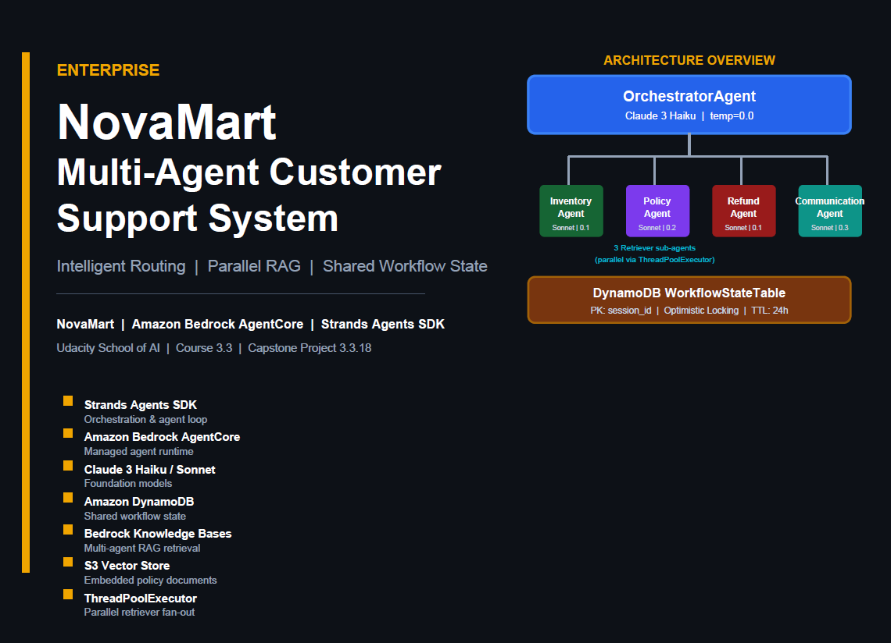
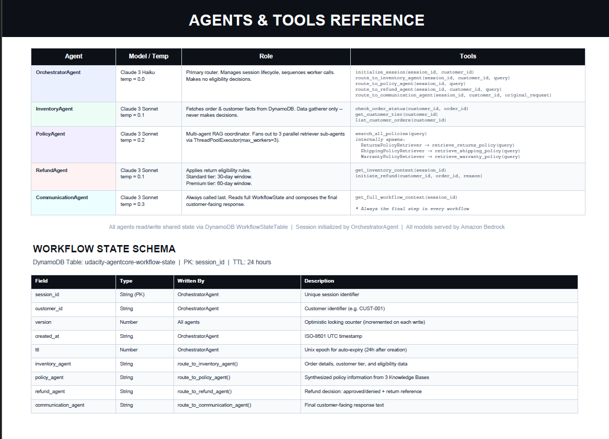
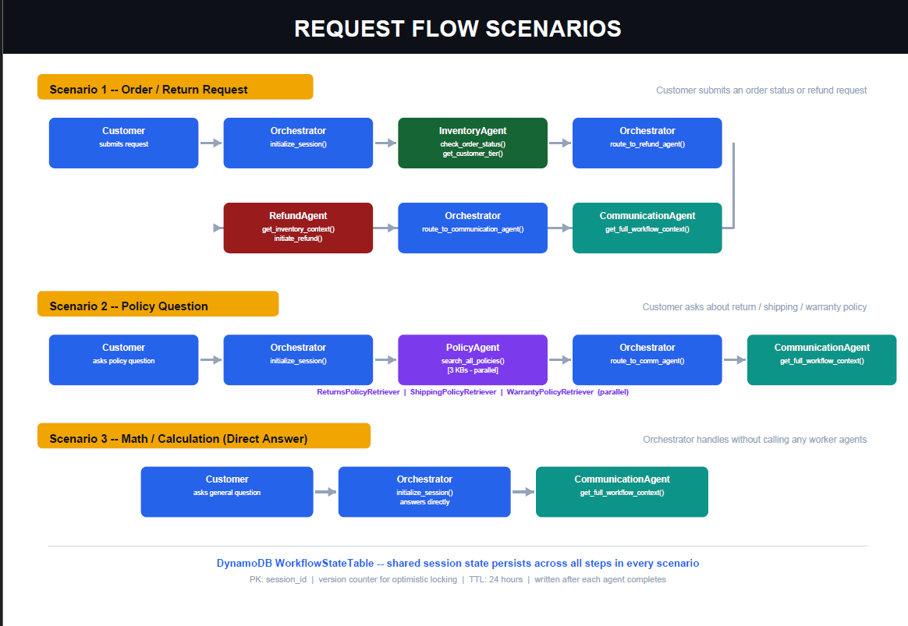

# ShopStream

Multi-agent customer support for a fictional retailer. Incoming requests are routed to specialist agents that look up orders, retrieve return/shipping/warranty policy, decide refund eligibility, and draft the customer reply.

Built with the [Strands Agents SDK](https://github.com/strands-agents/sdk-python) and [Amazon Bedrock AgentCore](https://docs.aws.amazon.com/bedrock-agentcore/latest/devguide/). Policy answers come from three Bedrock Knowledge Bases on S3 Vectors. Shared session state lives in DynamoDB. Bedrock Guardrails filter unsafe content. CloudWatch and X-Ray show the full call chain.



## Architecture

```
Customer Request
      │
OrchestratorAgent (Claude Haiku 4.5 - routes requests, manages WorkflowState)
      │
   ┌──┼──────────────────────────┬──────────────────┐
   │  │                          │                  │
InventoryAgent    PolicyAgent    RefundAgent    CommunicationAgent
(DynamoDB)     (Multi-Agent RAG)  (DynamoDB)     (synthesizes response)
                     │
         ┌───────────┼───────────┐
    ReturnsPolicyRetriever  ShippingPolicyRetriever  WarrantyPolicyRetriever
    (Bedrock KB)          (Bedrock KB)              (Bedrock KB)
         └───────── run in PARALLEL ───────────┘

Shared State: DynamoDB WorkflowStateTable (with optimistic locking)
```

### Agents

| Agent | Model | Role | Tools |
|-------|-------|------|-------|
| **OrchestratorAgent** | Claude Haiku 4.5 | Routes the request and owns WorkflowState | `initialize_session`, `route_to_inventory_agent`, `route_to_policy_agent`, `route_to_refund_agent`, `route_to_communication_agent` |
| **InventoryAgent** | Claude Sonnet 4.5 | Order and customer facts from DynamoDB | `check_order_status`, `get_customer_tier`, `list_customer_orders` |
| **PolicyAgent** | Claude Sonnet 4.5 | Parallel RAG across three knowledge bases; merges and deduplicates hits | `search_all_policies` |
| **RefundAgent** | Claude Sonnet 4.5 | Return/refund eligibility (30-day Standard, 60-day Premium) | `get_inventory_context`, `initiate_refund` |
| **CommunicationAgent** | Claude Sonnet 4.5 | Final customer-facing reply | `get_full_workflow_context` |



The orchestrator always starts a session, always finishes with CommunicationAgent, and never writes the customer reply itself:

| Trigger | Routing |
|---------|---------|
| Every request | `initialize_session` first, CommunicationAgent last |
| Order status, return, or refund | Inventory → Refund → Communication |
| Policy questions (windows, rates, terms) | Policy → Communication |
| Account questions (“what is my tier?”) | Inventory only — Policy has policy text, not customer records |
| Math / calculation | Communication only (no Inventory, Policy, or Refund) |



### What the stack includes

- **Parallel RAG** — PolicyAgent fans out to three retriever sub-agents with `ThreadPoolExecutor`, then merges results by relevance
- **Shared workflow state** — DynamoDB `WorkflowStateTable` with version-based optimistic locking
- **Guardrails** — Bedrock Guardrails for harmful content, PII, and off-topic traffic
- **Observability** — X-Ray traces (Orchestrator → worker → Knowledge Base) and CloudWatch Logs, locally and on the runtime
- **Knowledge Bases** — S3 Vectors backing store (vector bucket + one index per KB, created by CloudFormation)

Core implementation is `src/agent_orchestrator.py`.

## Prerequisites

- Python 3.12 (same as the deployed runtime)
- AWS account with Bedrock in `us-east-1`
- IAM access for Bedrock, Bedrock AgentCore, DynamoDB, S3, S3 Vectors, CloudFormation, CloudWatch, X-Ray, plus CDK bootstrap (`cloudformation:*`, `iam:PassRole`)
- Node.js 20+ and [uv](https://docs.astral.sh/uv/getting-started/installation/) for the AgentCore CLI
- AgentCore CLI **0.30.0** (`npm` package [`@aws/agentcore`](https://github.com/aws/agentcore-cli)):

  ```bash
  npm install -g @aws/agentcore@0.30.0
  agentcore --version
  ```

  This CLI replaced the older Python `bedrock-agentcore-starter-toolkit`. Both install an `agentcore` command — uninstall the toolkit if it is still on your PATH: `pip uninstall bedrock-agentcore-starter-toolkit`.

The runtime is arm64 / Python 3.12. `agentcore deploy` pulls matching wheels with `uv` (needs network access).

## Setup

Run these from this directory (`starter/`).

### 1. Install Python dependencies

```bash
pip install -r requirements.txt
```

### 2. Environment file

```bash
cp .env.example .env
```

`PROJECT_NAME` defaults to `shopstream-support`. Table names, buckets, the execution role, and the log group are read from CloudFormation exports — they do not belong in `.env`. Knowledge Base IDs, the runtime ARN, and the guardrail ID/version do, and are filled in as you create those resources.

### 3. Deploy foundation infrastructure

```bash
aws cloudformation deploy \
  --template-file infrastructure/stack.yaml \
  --stack-name shopstream-support \
  --parameter-overrides ProjectName=shopstream-support \
  --capabilities CAPABILITY_NAMED_IAM \
  --region us-east-1
```

The stack creates DynamoDB tables, the S3 policy-docs bucket, an S3 Vectors bucket with three indexes, the AgentCore execution role, and the CloudWatch log group.

Confirm exports loaded:

```bash
python config.py
```

Knowledge Base IDs, the runtime ARN, and the guardrail showing `(not yet created)` is expected until those steps below.

### 4. Seed sample data

After the stack is `CREATE_COMPLETE`:

```bash
python infrastructure/seed_data.py
```

This loads four mock customers (`CUST-001` … `CUST-004`) and their orders, and uploads policy documents under `policies/returns/`, `policies/shipping/`, and `policies/warranty/`. Order IDs used by `test`, `chat`, and `demo` (for example `ORD-27176`) come from this seed.

### 5. Create Knowledge Bases

Bedrock Knowledge Bases are created in the AWS Console. The S3 data bucket and S3 Vectors bucket are shared; only the prefix and vector index differ. `python config.py` prints the exact bucket and index names for your account.

| Setting | Returns | Shipping | Warranty |
|---------|---------|----------|----------|
| S3 data bucket | Policy Bucket from `python config.py` | same | same |
| S3 prefix | `policies/returns/` | `policies/shipping/` | `policies/warranty/` |
| Embedding model | `amazon.titan-embed-text-v2:0` | same | same |
| Vector store | S3 Vectors → use an existing vector bucket | same | same |
| Vector bucket | Vector Bucket from `python config.py` | same | same |
| Vector index | `returns-policy-index` | `shipping-policy-index` | `warranty-policy-index` |

Use a self-managed Knowledge Base with the existing S3 Vectors store. Do not Quick-create a new vector store — the stack already provisioned the bucket and indexes (dimension 1024, cosine, `AMAZON_BEDROCK_TEXT`). After each KB is created, **Sync** its data source.

Put the IDs in `.env`:

```
RETURNS_KB_ID=
SHIPPING_KB_ID=
WARRANTY_KB_ID=
```

If you already deployed the runtime before these IDs existed, run `python src/agent_orchestrator.py deploy` again. Editing `.env` locally does not update the deployed runtime.

### 6. Check the AgentCore CLI

```bash
agentcore --version      # 0.30.0 or newer
agentcore validate       # checks agentcore/agentcore.json
```

## Run locally

Three canned scenarios against the local agent graph:

```bash
python src/agent_orchestrator.py test
```

| Example | Expected path |
|---------|----------------|
| `"I want to return my order ORD-27176"` (CUST-001) | Inventory → Refund → Communication |
| `"What is the return policy for premium customers?"` | Policy (three parallel KB retrievers) → Communication |
| `"How much are 5 items at $29.99 with 10% off?"` | Communication only |

Interactive session with a color-coded per-agent trace:

```bash
python src/agent_orchestrator.py chat
```

## Deploy

```bash
python src/agent_orchestrator.py deploy
```

That pipeline:

| Step | Action |
|------|--------|
| 1 | Build the five-agent graph locally |
| 2 | Create the Bedrock Guardrail (content filters, PII, blocked topics, profanity) and a numbered version |
| 3 | Stage code in `build/runtime/`, write env vars into `agentcore/agentcore.json`, run `agentcore deploy -y` (CDK stack `AgentCore-shopstream-default`) |
| 4 | Create AgentCore Memory (`SESSION_SUMMARY`, 7-day event expiry) |
| 5 | Turn on CloudWatch logs and X-Ray Transaction Search (100% sampling in this setup); a second `agentcore deploy -y` applies runtime env vars |
| 6 | Optional AgentCore Gateway — skipped unless you set Lambda function names in `.env` |

The first deploy bootstraps CDK (`CDKToolkit`) and can take 5–10 minutes. Later runs update in place if the runtime changed.

Copy the printed values into `.env`:

```
AGENTCORE_RUNTIME_ARN=<printed arn>
GUARDRAIL_ID=<printed id>
GUARDRAIL_VERSION=<printed version>
```

`agentcore status` shows the same runtime ARN.

### Invoke the deployed runtime

```bash
python src/agent_orchestrator.py invoke "What is the return policy for premium customers?" CUST-002

agentcore invoke "What is the return policy for premium customers?"
agentcore invoke '{"prompt": "I want to return my order ORD-27176", "customer_id": "CUST-001"}'
agentcore status
agentcore logs
```

Guardrails are applied on every model call via `_apply_guardrail()` whenever `GUARDRAIL_ID` and `GUARDRAIL_VERSION` are set (from `.env` locally, from runtime env vars when deployed).

### Optional gateway

Leave `ORDERS_FUNCTION`, `POLICY_FUNCTION`, and `CUSTOMERS_FUNCTION` unset to skip gateway creation. Agents keep using in-process tools. Wiring them through MCP is a separate step.

## Tests

```bash
python tests/test_agent.py all
```

Or one group at a time:

```bash
python tests/test_agent.py task2   # agent graph and routing
python tests/test_agent.py task3   # runtime + guardrail
python tests/test_agent.py task4   # memory
python tests/test_agent.py task5   # knowledge base retrieval
python tests/test_agent.py task6   # observability
```

After a live `test` or `chat` run, the X-Ray service map is under **CloudWatch → X-Ray traces → Service map** (last 5 minutes; allow 30–60 seconds). You should see `ShopStream-Orchestrator` → workers → `KnowledgeBase:*`.

## Project layout

```
starter/
├── config.py                  # CloudFormation exports + env vars
├── requirements.txt
├── .env.example
├── agentcore/
│   ├── agentcore.json         # runtime definition used by `agentcore deploy`
│   ├── aws-targets.json       # filled in on first deploy
│   └── cdk/                   # CDK app managed by the CLI
├── src/
│   ├── agent_orchestrator.py  # agents, tools, deploy pipeline
│   ├── agent_utils.py         # terminal trace UI
│   ├── agent_observability.py # X-Ray + CloudWatch
│   ├── agentcore_cli.py       # wrapper around the AgentCore CLI
│   ├── bedrock_kb_retrieval.py
│   └── demo.py
├── infrastructure/
│   ├── stack.yaml
│   ├── seed_data.py
│   └── cleanup.py
└── tests/
    └── test_agent.py
```

`build/runtime/` is created at deploy time and is gitignored.

## Environment variables

```bash
AWS_REGION=us-east-1
PROJECT_NAME=shopstream-support

RETURNS_KB_ID=
SHIPPING_KB_ID=
WARRANTY_KB_ID=

AGENTCORE_RUNTIME_ARN=
GUARDRAIL_ID=
GUARDRAIL_VERSION=
```

Optional local overrides: `AGENT_TRACING_ENABLED`, `AGENT_TRACE_SAMPLING_RATE`, `AGENT_LOG_LEVEL`.

## Cleanup

```bash
python infrastructure/cleanup.py          # dry run
python infrastructure/cleanup.py --yes    # delete
```

Deletes Knowledge Bases (and console-created service roles), the AgentCore CLI stack (`AgentCore-shopstream-default`) and Memory, the Guardrail, policy-bucket objects, the CloudFormation stack, and runtime log groups. KB and AgentCore deletes are asynchronous — run it a second time to confirm. Add `--disable-transaction-search` to turn CloudWatch Transaction Search back off.

## Troubleshooting

**Config looks empty?** Run `python config.py` first.

| Variable | Source | If missing |
|----------|--------|------------|
| DynamoDB tables, S3 + S3 Vectors buckets, IAM role, log group | CloudFormation exports | Stack `shopstream-support` in `us-east-1` should be `CREATE_COMPLETE` |
| `RETURNS_KB_ID`, `SHIPPING_KB_ID`, `WARRANTY_KB_ID` | `.env` | Create and sync the three KBs, then paste IDs |
| `AGENTCORE_RUNTIME_ARN` | `.env` | Run `python src/agent_orchestrator.py deploy` and paste the ARN |
| `GUARDRAIL_ID`, `GUARDRAIL_VERSION` | `.env` | Same deploy command prints these |

**`check_order_status` key-schema error?** Orders use `customer_id` + `order_id` — pass both to `get_item`.

**X-Ray traces missing?** Each `test` / `chat` / `demo` run prints `X-Ray trace <id> published`. If it says *not published*, the warning above it is usually missing `xray:PutTraceSegments` or `AGENT_TRACING_ENABLED=false`. In the console use a short window (“Last 5 minutes”).

**`agentcore: command not found` or toolkit-style help (`configure`, `launch`)?** Install `@aws/agentcore@0.30.0` and uninstall `bedrock-agentcore-starter-toolkit`.

**`agentcore deploy` packaging errors?** The CLI runs `uv pip install` for Python 3.12 / aarch64. Needs `uv` and network. `python src/agentcore_cli.py` shows what the wrapper sees; logs are under `agentcore/.cli/logs/`.

**CDK / CloudFormation errors on deploy?** First deploy creates `CDKToolkit`. Check `AgentCore-shopstream-default` in CloudFormation, fix the failing resource, then re-run `python src/agent_orchestrator.py deploy` or `agentcore deploy -y`.

## References

- [Strands Agents SDK](https://github.com/strands-agents/sdk-python)
- [Amazon Bedrock AgentCore](https://docs.aws.amazon.com/bedrock-agentcore/latest/devguide/)
- [AgentCore CLI](https://github.com/aws/agentcore-cli) — [commands](https://github.com/aws/agentcore-cli/blob/main/docs/commands.md), [configuration](https://github.com/aws/agentcore-cli/blob/main/docs/configuration.md)
- [Bedrock Knowledge Bases](https://docs.aws.amazon.com/bedrock/latest/userguide/knowledge-base.html)
- [Bedrock Guardrails](https://docs.aws.amazon.com/bedrock/latest/userguide/guardrails-create.html)
- [DynamoDB optimistic locking](https://docs.aws.amazon.com/amazondynamodb/latest/developerguide/transaction-apis.html)

## License

[License](../../LICENSE.md)
